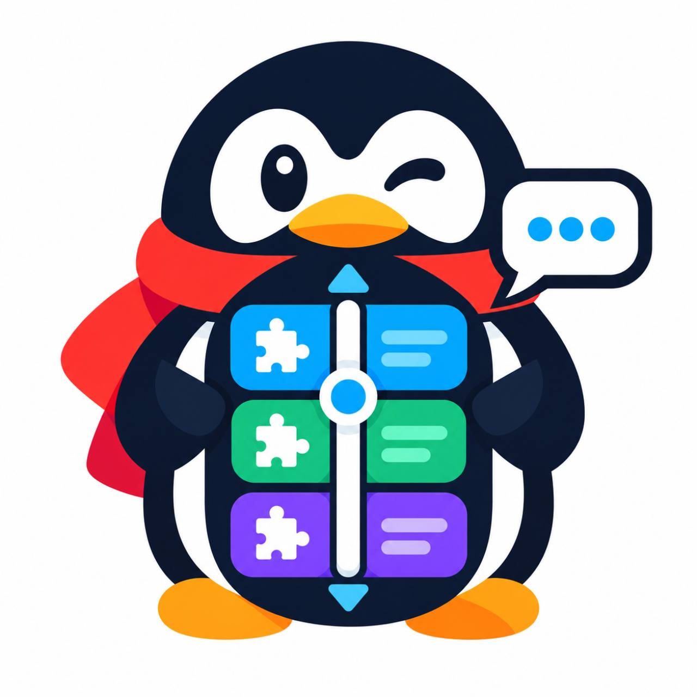

# QIII

QQ 的 Xposed 模块，统一管理 QA、QFun 和 ono。

- 重复功能排序，初始化失败时切换备用模块。
- QQ 与模块消息长按菜单的隐藏和排序。
- 消息翻译、一键翻译当前屏幕、Google 识图。

目前适配 QQ 9.3.75，使用LSPosed或兼容框架。安装后勾选 QQ 作用域并完整重启 QQ，可从 QQ 设置或独立 APP 进入。

模块接管需配合本账号下的 [QA](https://github.com/EntID-Ke/QAuxiliary)、[QFun](https://github.com/EntID-Ke/QFun)、[ono](https://github.com/EntID-Ke/ono) 适配版，默认不接管。

构建需要 JDK 21、Android SDK 37：`./gradlew :app:assembleDebug`。
